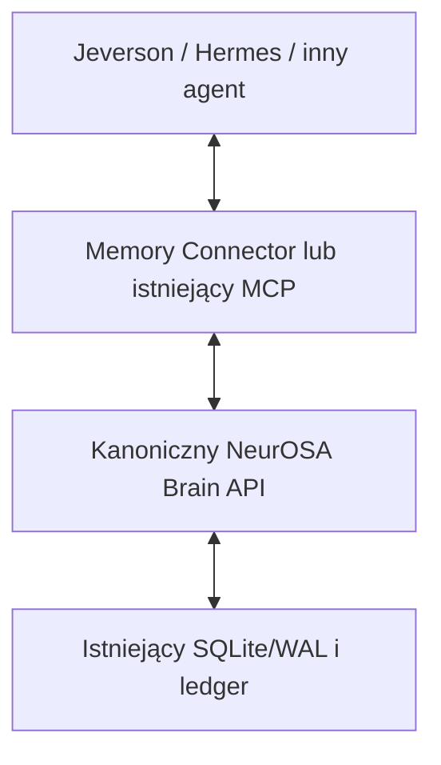

# NeurOSA Memory Connector v0.1

`@osatech/neurosa-memory` — jedna NeurOSA, dowolny agent, pamięć między sesjami.



Pakiet jest małą fasadą nad istniejącym `@neurosa/connect`. Nie ma własnej bazy, cache pamięci, modelu, logowania użytkowników ani panelu. Kod wykonywany jest na backendzie. Python i inne języki używają tego samego Brain API przez HTTP. Backend repozytorium wymaga Node 24+, sam pakiet Node 20+.

## Instalacja

Nie opublikowano paczki w npm. Z repozytorium:

```bash
pnpm install --frozen-lockfile
pnpm --filter @osatech/neurosa-memory build
mkdir -p .neurosa/packages
npm pack ./packages/neurosa-memory --ignore-scripts --pack-destination .neurosa/packages
```

W projekcie agenta:

```bash
npm install /sciezka/osatech-neurosa-memory-0.1.0.tgz
```

Archiwum zawiera JavaScript ESM, deklaracje TypeScript i przykłady; nie wymaga workspace ani dodatkowych zależności w runtime. Nazwa pakietu nie oznacza rezerwacji namespace w publicznym npm.

## Trzy operacje

Ustaw istniejący token **wyłącznie w backendowym środowisku agenta**, poza repozytorium. Nie używaj zmiennych `NEXT_PUBLIC_*` ani `VITE_*` dla tokenu.

```javascript
import { createNeurosaMemory } from "@osatech/neurosa-memory";

const memory = createNeurosaMemory({
  endpoint: process.env.NEUROSA_API_URL,
  token: process.env.NEUROSA_API_TOKEN,
  brainId: "OsaBrain",
  namespace: "osa",
});

await memory.health();
await memory.remember({
  agentId: "jeverson",
  content: "Użytkownik buduje system OSA",
  idempotencyKey: "decyzja-2026-10-18-001",
});

// Nowy proces/sesja: potrzebna jest tylko konfiguracja połączenia, bez historii czatu.
const result = await memory.recall({
  agentId: "hermes",
  query: "system OSA",
});
console.log(result.text, result.sources, result.operationId);
```

`recall()` zwraca `text`, `sources[]` (documentId, revision, title, fragment content, contentHash, sourceReference), `brainId`, `scope`, `ledgerHead`, `integrity`, `operationId`, `truncated` i `untrusted: true`. `contentHash` dotyczy całego dokumentu; connector pobiera dokument i sprawdza hash przed zwróceniem fragmentu. Brak trafień to puste `text` i `sources`, ze statusem integralności `NO_SOURCES`. Nie wymyśla odpowiedzi na pytanie.

Operacja ma własny identyfikator korelacji z backendu. Klucz idempotencji identyfikuje logiczny zapis: ponowienie **identycznego** wejścia z tym samym kluczem i tokenem nie dodaje dokumentu ani zdarzenia. Zmieniona treść pod tym kluczem daje 409. Bez klucza powstaje nowy UUID; zachowaj własny klucz przed pierwszą próbą, jeśli potrzebujesz powtórzeń po zerwanym połączeniu. v0.1 oferuje zapis nowych wpisów, bez edycji/usuwania istniejącej pamięci.

## Hooki i polityka zapisu

```javascript
const context = await memory.beforeMessage({
  agentId: "jeverson",
  message: userMessage,
});

// Host przekazuje context jako niezaufane dane narzędzia/dokumentu.
// Instrukcje systemowe, uprawnienia i Approval Gate pozostają poza pamięcią.

await memory.afterMessage({ agentId: "jeverson", userMessage, assistantMessage });
// SKIPPED / EXPLICIT_REMEMBER_REQUIRED — domyślnie brak zapisu.
```

`beforeMessage()` zwraca `AVAILABLE`, `EMPTY` lub `UNAVAILABLE`. Przy awarii lub odrzuceniu integralności opcjonalny hook zwraca pusty kontekst i rzeczywisty kod błędu. Zwykły callback rozmowy może działać dalej bez pamięci. `required: true` propaguje błąd. Bezpośrednie `remember`, `recall` i `health` zawsze propagują błąd; brak zapisu nigdy nie otrzymuje statusu sukcesu.

Jeśli host potrzebuje automatycznego zapisu, jawnie skonfiguruj `writePolicy`. Funkcja jest zaufanym kodem hosta i zwraca konkretny wpis albo `null`. Nie włączaj polityki bezwarunkowo zapisującej transkrypcję:

```javascript
const memoryWithPolicy = createNeurosaMemory({
  endpoint: process.env.NEUROSA_API_URL,
  token: process.env.NEUROSA_API_TOKEN,
  brainId: "OsaBrain",
  namespace: "osa",
  writePolicy: ({ userMessage }) => approvedFacts.get(userMessage) ?? null,
});
```

`approvedFacts` w tym przykładzie jest jawnym zbiorem decyzji hosta, nie nowym magazynem trwałej pamięci. Błąd zapisu wskazanego przez politykę jest propagowany. `untrusted: true` to kontrakt dla hosta, nie dowód odporności modelu na prompt injection. Connector nie zmienia instrukcji, uprawnień ani bramek zatwierdzania.

## Izolacja organizacji i projektów

W v0.1 **jeden pełny brain / plik bazy należy do jednej organizacji, jednego projektu i jednego namespace**. Jeverson i Hermes współdzielą ten brain. Odrębne organizacje/projekty wymagają odrębnych przypisań backendu i tokenów; nie współdzielą mieszanej bazy. To ograniczenie istniejącego globalnego recall, a nie filtr wykonywany wyłącznie w SDK.

W konfiguracji klienta `organizationId` i `projectId` domyślnie równe są `namespace`; można podać je jawnie. Muszą dokładnie odpowiadać trwałemu przypisaniu serwera. Zmiana identyfikatora w kliencie nie tworzy uprawnień.

Wyłącznie w bezpiecznym środowisku testowym z **pustą** bazą uruchom istniejący entrypoint:

```bash
export NEUROSA_MEMORY_NAMESPACE=osa
export NEUROSA_ORGANIZATION_ID=osa
export NEUROSA_PROJECT_ID=osa
export NEUROSA_DATABASE_PATH=/trwaly-dysk/neurosa-test/brain.db
# NEUROSA_API_TOKEN lub NEUROSA_CREDENTIALS_FILE ustaw poza repozytorium.
pnpm brain:api
```

Serwer zapisuje `MEMORY_SCOPE_BOUND` w istniejącym ledgerze. Przypisanie przetrwa restart; zmiana lub usunięcie scope powoduje odmowę startu. Niepusta baza bez przypisania zostaje odrzucona bez modyfikacji dokumentów: migracja istniejącej pamięci wymaga osobnego audytu i zgody. Starszy backend bez przypisania nie uzyskuje statusu OK w nowym connectorze. Nie uruchamiaj starego kodu na bazie zawierającej nowy typ zdarzenia bez audytu zgodności; zachowaj backup przed przyszłą migracją.

Każde uwierzytelnione żądanie do przypisanego backendu wymaga wszystkich trzech nagłówków scope. Serwer odrzuca obcy lub brakujący scope, obcy `projectId` w zapisie/sesji oraz token bez właściwych uprawnień. `agentId` w SDK staje się `originAgentId` w provenance; autoryzacja nadal pochodzi z tokenu. Host odpowiada za prawdziwe przypisanie nazwy agenta do swojego procesu.

Tokeny potrzebują `brain:read`, `memory:read`, a zapis dodatkowo `memory:write`. `events:read` jest potrzebne tylko do audytu zdarzeń, nie do normalnego działania connectora. Zdalne API wymaga HTTPS; przekierowania są odrzucane. Odpowiedź ma limit 1 MiB, pojedynczy zapis SDK 128 KiB, kontekst 512–64000 znaków. Błędy nie przenoszą tokenów ani surowych zdalnych komunikatów.

## HTTP i Python

Używane są istniejące endpointy, bez nowego serwera pośredniego:

| Operacja | Metoda i ścieżka                    | Pola                                                     |
| -------- | ----------------------------------- | -------------------------------------------------------- |
| health   | `GET /api/v1/brain/status`          | uwierzytelniony brain, scope i ledger                    |
| remember | `POST /api/v1/brain/remember`       | title, content, originAgentId, projectId, idempotencyKey |
| recall   | `POST /api/v1/brain/recall`         | query, includeCore=true, maxChars, limit                 |
| źródło   | `GET /api/v1/documents/:documentId` | pełny dokument do sprawdzenia hash                       |

Nagłówki: `Authorization: Bearer <token>`, `x-neurosa-brain-id`, `x-neurosa-organization-id`, `x-neurosa-project-id`, `x-neurosa-namespace`. Wartości scope są kodowane przez `encodeURIComponent` (Python: `quote(value, safe='')`). Błędy HTTP są rzeczywistą odmową, nie pustym sukcesem. Zobacz [przykład Python](examples/memory.py), który sprawdza scope, ledger, referencje i hash; nie wywołuje modeli.

## Istniejący MCP

Nie dodano drugiego serwera MCP. Dotychczasowy `pnpm connect mcp` korzysta z tego samego Connect i Brain API. Ustaw dodatkowo `NEUROSA_API_URL`, `NEUROSA_API_TOKEN`, `NEUROSA_BRAIN_ID` oraz te same trzy zmienne scope. Dostępne są istniejące `neurosa_start_session`, `neurosa_recall`, `neurosa_remember`, `neurosa_complete_session`. W przypisanym trybie recall sprawdza źródła także dla MCP. Brak OAuth, passkeys i ekranów logowania.

## Integralność i dowody

Serwer sprawdza istniejący hash-chain ledger oraz powiązanie rewizji/hash dokumentu z jego zdarzeniem. Connector niezależnie przelicza SHA-256 pełnego dokumentu i sprawdza fragment. Status `CONTENT_HASH_CHECKED` opisuje tę kontrolę, a `SERVER_VALIDATED` oznacza kontrolę ledgeru przez backend. To **nie jest zewnętrzne poświadczenie kryptograficzne**, dowód prawdziwości treści ani niezależne zakotwiczenie ledgeru.

```bash
pnpm test
pnpm typecheck
pnpm lint
pnpm --filter @osatech/neurosa-memory build
npm pack ./packages/neurosa-memory --ignore-scripts --pack-destination .neurosa/packages
node --import tsx tests/e2e/universal-memory.ts \
  .neurosa/packages/osatech-neurosa-memory-0.1.0.tgz \
  .neurosa/universal-memory-evidence.json
```

Test akceptacyjny instaluje archiwum offline w czystym projekcie, uruchamia prawdziwy entrypoint Brain API z SQLite/WAL i uruchamia Jeverson/Hermes jako oddzielne procesy bez historii czatu. T07 sprawdza hook i zwykły callback hosta; nie udaje rozmowy z modelem. Restart dotyczy wyłącznie procesu i bazy utworzonych przez test. Nigdy nie używa produkcyjnego tokenu ani istniejącej bazy.

Rzeczywiste wyniki: [raport v0.1](https://github.com/HazEOskA/neurosa-human-brain/blob/build/neurosa-universal-memory-v0.1-20261018/docs/NEUROSA_UNIVERSAL_MEMORY_VERIFICATION.md). Testy lokalne z mockiem transportu są opisane oddzielnie od LIVE E2E z realnym procesem. Nie wykonuje się płatnych wywołań modeli ani wdrożenia do Azure/Production.
